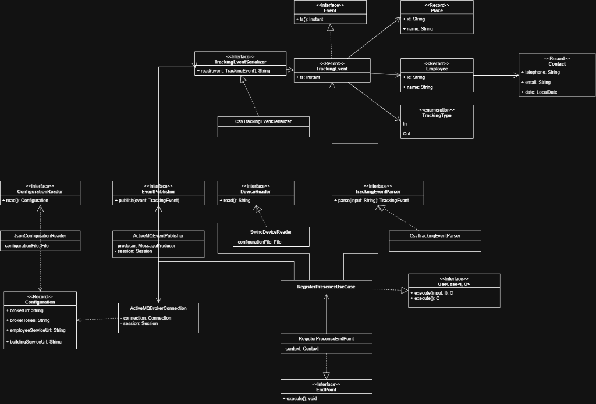
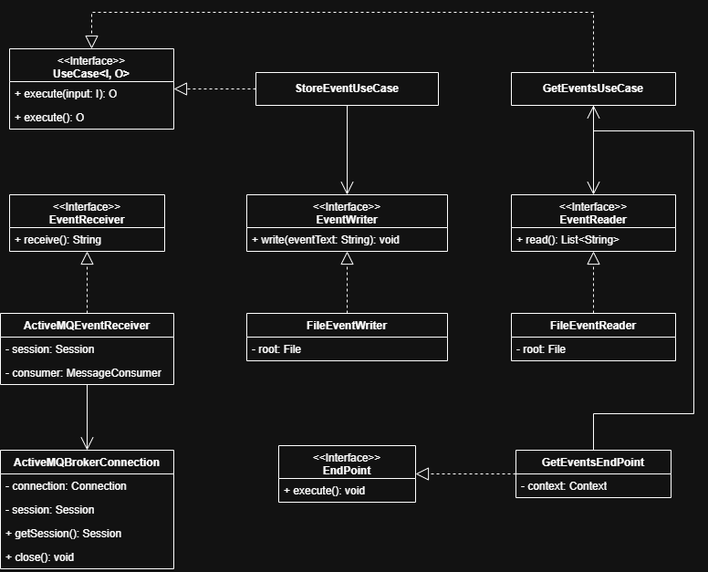
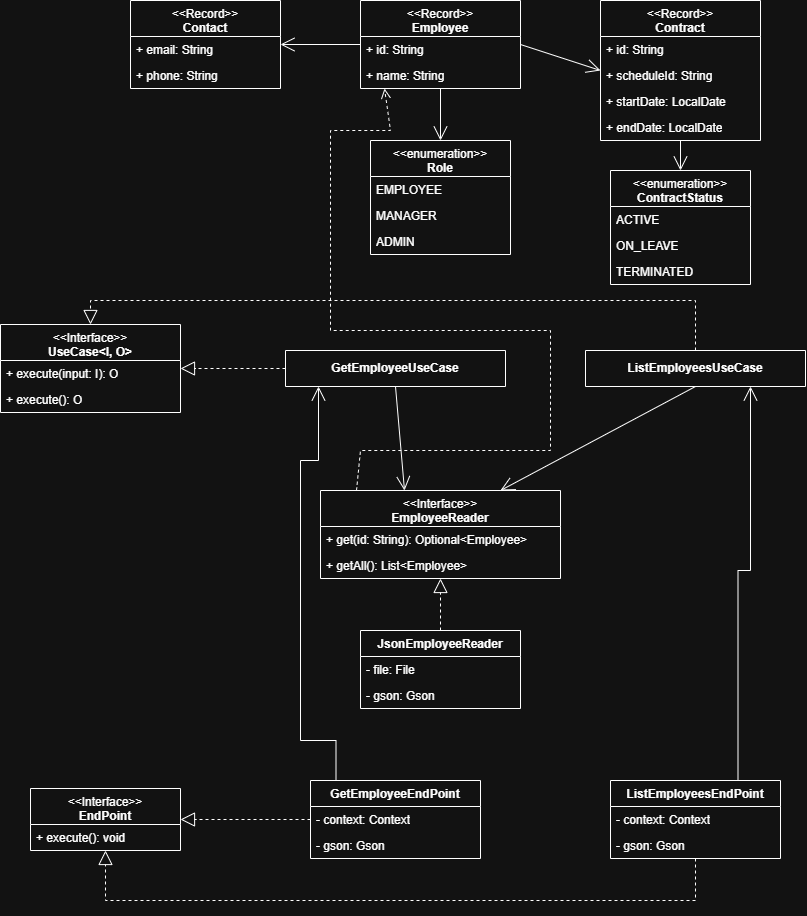
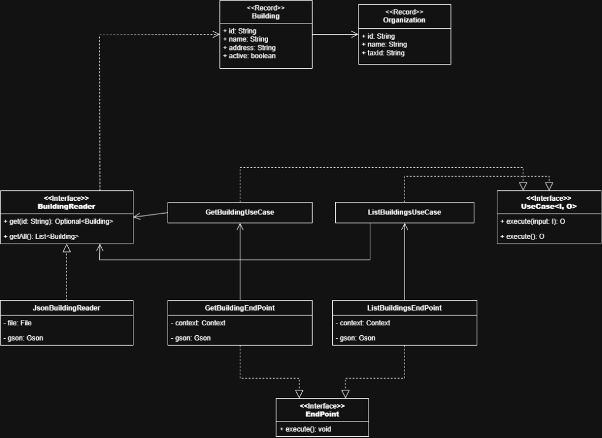

# ⏱️ Sistema Distribuido de Control de Presencia y Gestión Horaria

[](https://openjdk.org/)
[](https://maven.apache.org/)
[-blue?logo=apache&logoColor=white)](https://activemq.apache.org/)
[](https://javalin.io/)
[](https://junit.org/junit5/)
[-blueviolet)](docs/README.md)

Proyecto de la asignatura **Ingeniería del Software 2 (ULPGC)**. Sistema distribuido de control de presencia, gestión de turnos laborales y auditoría horaria diseñado bajo **Arquitectura Hexagonal (Puertos y Adaptadores)**, Inversión de Dependencias pura (**Pure DI**) y mensajería asíncrona tolerante a fallos.

> 📖 **Centro de Documentación Técnica:** Consulta [`docs/README.md`](docs/README.md) para el índice general, [`docs/architecture.md`](docs/architecture.md) para los flujos de red y [`docs/diagrams/`](docs/diagrams/README.md) para los diagramas de clases UML completos.

---

## 1. 🎯 Objetivo y Modelo de Negocio

El sistema gestiona de forma distribuida el registro puntual de asistencia (`In` / `Out`) de empleados, desacoplando completamente los dispositivos de captura de presencia del almacenamiento histórico y de los servicios de consulta.

### Regímenes Horarios Soportados (Rúbrica IS2)
El sistema modela y audita **3 regímenes laborales** bien diferenciados:
1. **Jornada Continua de Oficina:** Horario fijo estándar (ej. 08:00 a 16:00).
2. **Jornada Partida Comercial:** Dos bloques diarios con descanso intermedio (ej. 09:00 a 14:00 y 17:00 a 20:00).
3. **Turnos Rotativos 24/7 (Hospitalario / Industrial):** Turnos rotativos continuos (Mañana, Tarde y Noche).

---

## 2. 📐 Diagramas de Clases UML y Arquitectura Hexagonal

Cada microservicio aísla estrictamente su Core (`architecture`) de la infraestructura y frameworks (`infrastructure`). A continuación se detallan los diagramas de clases UML oficiales de los módulos implementados:

### A. Módulo `tracking-service` (Capturador y Productor)
Gestiona la lectura de presencia desde terminales físicos o llamadas HTTP y publica los eventos de forma individual en el broker JMS.
*(Detalle completo en [`docs/diagrams/tracking-service-class-diagram.png`](docs/diagrams/tracking-service-class-diagram.png))*



### B. Módulo `storer` (Data Lake y Persistencia Asíncrona)
Consume eventos de ActiveMQ con confirmación segura `CLIENT_ACKNOWLEDGE`, particiona los fichajes cronológicamente en disco (`store/YYYY/MM/YYYYMMDD.log`) y sirve el visor web de auditoría.
*(Detalle completo en [`docs/diagrams/storer-class-diagram.png`](docs/diagrams/storer-class-diagram.png))*



### C. Módulo `employee-service` (Catálogo de Trabajadores y Contratos)
Microservicio con API REST para la gestión y consulta de trabajadores, roles, contactos y contratos vinculados a los regímenes horarios.
*(Detalle completo en [`docs/diagrams/employee-service-class-diagram.png`](docs/diagrams/employee-service-class-diagram.png))*



### D. Módulo `building-service` (Catálogo de Sedes y Centros de Trabajo)
Microservicio con API REST para la gestión de edificios, ubicaciones y organizaciones asociadas.
*(Detalle completo en [`docs/diagrams/building-service-class-diagram.png`](docs/diagrams/building-service-class-diagram.png))*



---

## 3. 🛠️ Dependencias y Entorno de Desarrollo

- **JDK:** Oracle OpenJDK 27 (compatible con JDK 21+).
- **Gestor de construcción:** Apache Maven multimodular (`pom.xml` padre en raíz y módulos bajo `backend/`).
- **Librerías principales:**
  - `Javalin 6.1.3`: Servidor HTTP ligero y sin reflexión para los adaptadores web.
  - `SLF4J Simple 2.0.9`: Fachada de logging para Javalin y ActiveMQ.
  - `ActiveMQ Client 5.18.3`: Conexión JMS con el broker de mensajería.
  - `Gson 2.11.0`: Deserialización JSON desacoplada de la lógica de dominio.
  - `JUnit 5 (6.1.3)` & `AssertJ Core (3.27.7)`: Pruebas unitarias automatizadas con aserciones fluidas.
  - `DataFaker 2.0.2`: Generación de datos sintéticos realistas para pruebas de carga.

---

## 4. 🚀 Compilación y Ejecución

### Requisitos previos
Tener en ejecución un broker **Apache ActiveMQ** (vía Docker o local) escuchando en `tcp://localhost:61616`.

```bash
# Compilar todos los módulos del backend desde la raíz:
mvn compile

# Ejecutar la suite completa de pruebas unitarias automatizadas:
mvn test
```

### Ejecución de los Servicios Distribuidos
Cada microservicio corre de forma autónoma en su propio puerto y proceso:

1. **Arrancar el Ingestor / Consumidor (`storer` - Puerto 7071):**  
   Ejecutar la clase `Main` en `backend/storer`.
   - Drena de forma secuencial y sin hilos la cola `fichajes.queue` con timeout de 2000 ms.
   - Persiste de forma atómica en el Data Lake y mantiene activo el servidor web en `http://localhost:7071/` para consulta.
2. **Arrancar el Capturador / Productor (`tracking-service` - Puerto 7070):**  
   Ejecutar la clase `Main` en `backend/tracking-service`.
   - Lanza la interfaz gráfica interactiva Swing (`SwingDeviceReader`) con botón *"¡He llegado!"* para simular un torno físico.
   - Mantiene activa la API HTTP en el puerto 7070 para emitir eventos a ActiveMQ.
3. **Arrancar el Servicio de Empleados (`employee-service` - Puerto 7072):**  
   Ejecutar la clase `Main` en `backend/employee-service`.
   - Expone la API REST de empleados en `http://localhost:7072/employees`.
4. **Arrancar el Servicio de Edificios (`building-service` - Puerto 7073):**  
   Ejecutar la clase `Main` en `backend/building-service`.
   - Expone la API REST de sedes en `http://localhost:7073/buildings`.

---

## 5. 📂 Estructura del Repositorio

```text
├── docs/                                               # Centro de documentación técnica
│   ├── README.md                                       # Índice maestro de documentación
│   ├── architecture.md                                 # Red de microservicios y flujos detallados
│   ├── agent.md                                        # Architecture Guardrails & Directrices de Calidad
│   ├── roadmap.md                                      # Planificación por fases y control de entrega
│   ├── diagrams/                                       # Diagramas de clases UML en alta resolución (PNG)
│   │   ├── README.md                                   # Explicación técnica de puertos y patrones
│   │   ├── tracking-service-class-diagram.png
│   │   ├── storer-class-diagram.png
│   │   ├── employee-service-class-diagram.png
│   │   └── building-service-class-diagram.png
│   └── images/                                         # Esquemas conceptuales y capturas
├── frontend/                                           # Directorio raíz para aplicaciones cliente
├── backend/                                            # Módulos del backend distribuido
│   ├── tracking-service/                               # Captura y emisión (Puerto 7070 & Swing GUI)
│   ├── storer/                                         # Consumo JMS y Data Lake (Puerto 7071)
│   ├── employee-service/                               # Catálogo de empleados y contratos (Puerto 7072)
│   ├── employee-admin/                                 # Consola de administración de empleados
│   ├── building-service/                               # Catálogo de sedes y edificios (Puerto 7073 - En curso)
│   └── building-admin/                                 # Consola de administración de sedes
└── store/                                              # Data Lake particionado cronológicamente
    └── YYYY/
        └── MM/
            └── YYYYMMDD.log
```

---

## 6. 🌐 Contrato de Comunicación HTTP

| Microservicio | Método | Ruta | Descripción | Código |
| :--- | :---: | :--- | :--- | :---: |
| **`tracking-service`** | `POST` / `GET` | `/events?event={ts;emp;place;type}` | Registra un fichaje y lo publica a ActiveMQ | `201 Created` |
| **`storer`** | `GET` | `/` o `/events` | Consulta el histórico completo del Data Lake | `200 OK` |
| **`employee-service`** | `GET` | `/employees` | Lista todos los empleados con contratos y horarios | `200 OK` |
| **`employee-service`** | `GET` | `/employees?id={id}` | Obtiene la ficha detallada de un empleado por ID | `200 OK` / `404` |
| **`building-service`** | `GET` | `/buildings` | Lista todas las sedes y centros de trabajo *(en desarrollo)* | `200 OK` |

---

## 7. 🧪 Verificación y Pruebas Unitarias

El proyecto cuenta con una batería completa de pruebas automatizadas con JUnit 5 y AssertJ en todos sus módulos:
- **`tracking-service`:** `RegisterPresenceUseCaseTest`, `JsonConfigurationReaderTest`, `ActiveMQEventPublisherTest`.
- **`storer`:** `StoreEventUseCaseTest`, `GetEventsUseCaseTest`, `FileEventWriterTest`, `ActiveMQEventReceiverTest`.
- **`employee-service`:** `GetEmployeeUseCaseTest`, `ListEmployeesUseCaseTest`, `JsonEmployeeReaderTest`.

---

## 8. 🛡️ Principios de Diseño para la Defensa (IS2)

1. **Pure DI:** Cero `new` dentro de clases de negocio o adaptadores. Todas las dependencias técnicas entran por constructor (`private final`) y se ensamblan únicamente en el Composition Root (`Main.java`).
2. **Sin Concurrencia Manual:** No se usan `Thread`, `Runnable` ni `ExecutorService` para la gestión de colas; el consumo se gestiona secuencialmente mediante timeouts JMS.
3. **Persistencia Garantizada:** `storer` solo confirma (`CLIENT_ACKNOWLEDGE`) tras asegurar el volcado físico en disco mediante `Files.writeString`.
