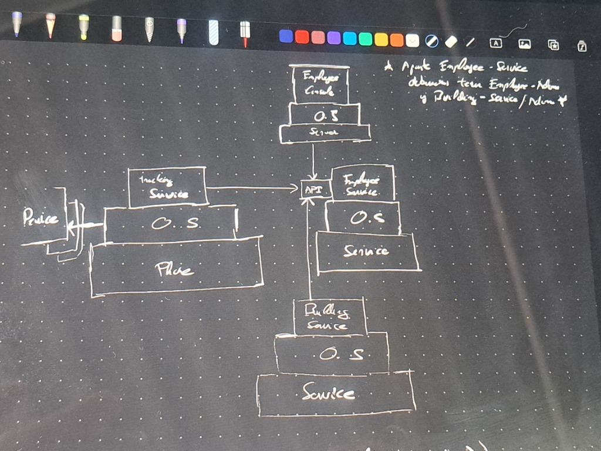
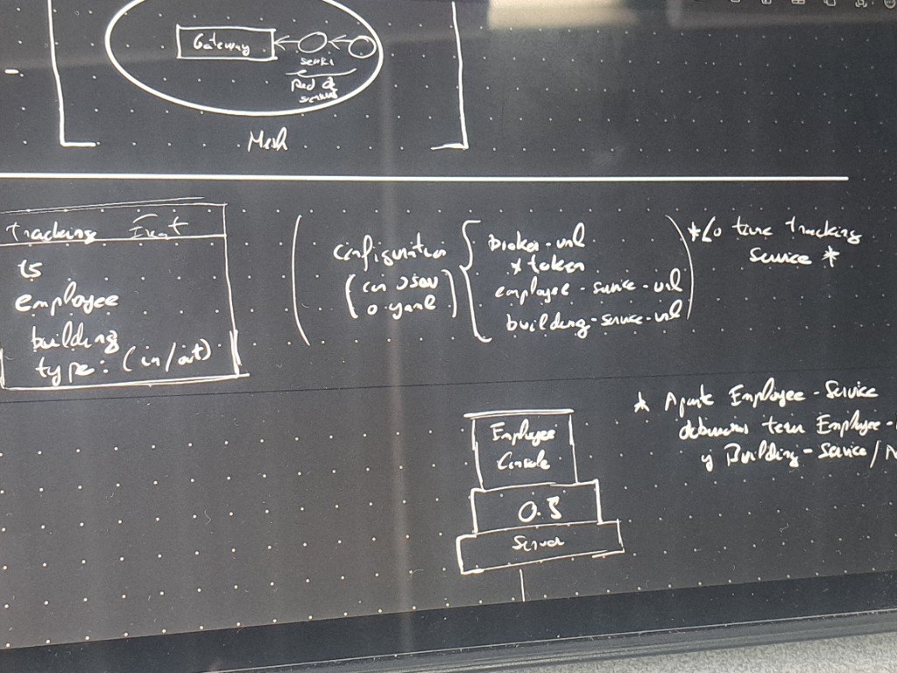

# Arquitectura y Flujos del Sistema — Control de Presencia (ULPGC)

Este documento describe de forma visual e inmediata cómo fluyen las acciones en el sistema distribuido de control de presencia, separando cada ciclo en su propio diagrama de flujo para que sea rápido y fácil de entender por el **Adri del futuro**.

---

## 1. Flujo 1: Registro y Emisión de un Fichaje (Módulo `tracking-service`)
Muestra cómo una petición HTTP externa entra por Javalin, atraviesa el caso de uso sin acoplamiento y viaja como mensaje ligero hacia la cola de ActiveMQ.

```text
[ Cliente Web / Navegador / Torno: POST o GET http://localhost:7070/events?employeeId=emp-01&placeId=Oficina&type=In ]
       │
       ▼ (Petición HTTP entrante)
[ Javalin Router (tracking-service/Main: puerto 7070) ]
       │
       ▼ (Enrutamiento dinámico con inyección del Context)
[ RegisterTrackingEndPoint.execute() ]
       │
       ├──> Extrae queryParam("employeeId") ──> "emp-01"
       ├──> Extrae queryParam("placeId")    ──> "Oficina"
       ├──> Extrae queryParam("type")       ──> "In"
       │
       ▼ (Instancia modelos ligeros del dominio)
[ Employee("emp-01"), Place("Oficina"), TrackingEvent(emp, place, type) ]
       │
       ▼ (Llamada al caso de uso puro)
[ RegisterTrackingEventUseCase.execute(event) ]
       │
       ▼ (Delega en el puerto de salida)
[ EventStore.tracking-service(event) ] (Interfaz del Core)
       │
       ▼ (Implementación concreta del adaptador)
[ ActiveMQEventStore.tracking-service(event) ]
       │
       ├──> serializa(event) ───────────────> "2026-11-02T15:00:00Z;emp-01;Oficina;In"
       │
       ▼ (Usa la Session inyectada de ActiveMQBrokerConnection)
[ MessageProducer.send(textMessage) ]
       │
       ▼ (Viaja por la red TCP tcp://localhost:61616)
[ Cola ActiveMQ: "fichajes.queue" ] ────────> Mensaje esperando en el broker
       │
       ▼
[ context.status(201).result("Tracking event tracking-serviceed") ] ──> Respuesta HTTP 201 al cliente
```

---

## 2. Flujo 2: Consumo y Persistencia en el Data Lake (Módulo `storer`)
Muestra el procesamiento de la cola de ActiveMQ hacia el sistema de archivos cronológico en disco, con confirmación segura `CLIENT_ACKNOWLEDGE` y parada limpia sin hilos.

```text
[ Cola ActiveMQ: "fichajes.queue" ]
       │
       ▼
[ ActiveMQEventReceiver.receive() ]
       │
       ▼ (consumer.receive(2000) ── Timeout de seguridad de 2 segundos)
       ├─ Si devuelve null ────────────────> Cola vacía, el bucle termina limpiamente (Sin hilos)
       └─ Si hay mensaje (TextMessage) ────> Extrae String plano del evento
       │
       ▼
[ StoreEventUseCase.execute(eventText) ] (Core de storer)
       │
       ▼ (Delega en el puerto EventRepository)
[ FileEventRepository.save(eventText) ]
       │
       ├──> Extrae timestamp del String: "2026-11-02T15:00:00Z"
       ├──> Calcula carpetas: store / YYYY / MM
       ├──> Calcula fichero: YYYYMMDD.log  (ej: store/2026/11/20261102.log)
       │
       ▼ (Escritura atómica en modo APPEND y UTF-8)
[ Files.writeString(logFile, row, APPEND) ] ──> ¡Fichaje guardado de forma permanente en disco!
       │
       ▼ (Solo tras asegurar el guardado en disco)
[ message.acknowledge() ] ─────────────────────> ActiveMQ ya puede borrar el mensaje de la cola
```

---

## 3. Flujo 3: Consulta del Histórico de Fichajes en el Data Lake (Módulo `storer`)
Muestra cómo el usuario o supervisor consulta en su navegador todos los eventos registrados sin tener que meter parámetros forzados.

```text
[ Navegador Web: GET http://localhost:7071/ ]
       │
       ▼
[ Javalin Router (storer/Main: puerto 7071) ]
       │
       ▼
[ GetEventsEndPoint.execute() ]
       │
       ▼ (Llamada limpia sin parámetros)
[ GetEventsUseCase.execute() ] (Core / application.usecases)
       │
       ▼ (Delega en el puerto EventReader)
[ FileEventReader.read() ] (infrastructure.adapters)
       │
       ├──> Files.walk(storeRoot) ─────────> Recorre todas las carpetas del Data Lake
       ├──> Filtra ficheros *.log ─────────> Lee cada línea cronológicamente
       │
       ▼
[ Retorna List<String> con todos los fichajes ]
       │
       ▼
[ String.join("\n", events) ]
       │
       ▼
[ context.result(listadoTexto) ] ───────────> Respuesta HTTP 200 con el histórico en pantalla
```

---

## 4. Mapa de Componentes: ¿Dónde vive cada pieza?

Para ubicar cualquier archivo en 2 segundos según la **Arquitectura Hexagonal** y la separación estricta de responsabilidades:

### Módulo `tracking-service` (Captura y Producción)
```text
backend/tracking-service/src/main/java/software/ulpgc/controlpresencia/
│
├── application/                         <-- EL CORE (Cero librerías externas ni frameworks web)
│   ├── model/                           <-- Entidades inmutables: Employee, Contact, Place, TrackingEvent, TrackingType
│   ├── ports/                           <-- Contratos de interfaz: EventStore
│   └── usecases/                        <-- Casos de uso: UseCase<I, O>, RegisterTrackingEventUseCase
│
├── infrastructure/                      <-- INFRAESTRUCTURA (Conexiones reales y web)
│   └── adapters/
│       ├── ActiveMQBrokerConnection.java <-- Gestor de sesión JMS (AutoCloseable)
│       ├── ActiveMQEventStore.java       <-- Implementación de EventStore con ActiveMQ
│       └── endpoints/                    <-- Adaptadores Web Javalin:
│           ├── EndPoint.java             <-- Interfaz base de endpoints
│           └── RegisterTrackingEndPoint.java <-- Traduce HTTP a llamadas de dominio
│
├── factories/                           <-- Generador simulado: TrackingEventFactory (DataFaker)
└── Main.java                            <-- COMPOSITION ROOT (Puerto 7070, ensambla con Pure DI y arranca)
```

### Módulo `storer` (Persistencia y Data Lake)
```text
backend/storer/src/main/java/software/ulpgc/controlpresencia/
│
├── application/                         <-- EL CORE (Reglas de persistencia puras)
│   ├── ports/                           <-- Contratos: EventReceiver, EventRepository, EventReader
│   └── usecases/                        <-- Casos de uso: StoreEventUseCase, GetEventsUseCase
│
├── infrastructure/                      <-- INFRAESTRUCTURA (Ficheros, ActiveMQ y Web)
│   └── adapters/
│       ├── ActiveMQBrokerConnection.java <-- Conexión JMS con CLIENT_ACKNOWLEDGE
│       ├── ActiveMQEventReceiver.java    <-- Consumidor con timeout de 2000ms
│       ├── FileEventRepository.java      <-- Escribe en store/YYYY/MM/YYYYMMDD.log
│       ├── FileEventReader.java          <-- Lee recursivamente los logs de store/
│       └── endpoints/                    <-- Adaptadores Web Javalin:
│           ├── EndPoint.java
│           ├── StoreEventEndPoint.java   <-- Sobrecarga limpia de execute(...)
│           └── GetEventsEndPoint.java    <-- Sirve el listado en GET /
│
└── Main.java                            <-- COMPOSITION ROOT (Puerto 7071, drena la cola y arranca)
```

---

## 5. Evolución hacia Microservicios Distribuidos (Portero)

A partir del diseño en clase y los esquemas en pizarra, el sistema evoluciona hacia una arquitectura de múltiples microservicios independientes comunicados mediante API y Message Broker, configurados de forma externa.

### 5.1. Esquemas de Pizarra y Red de Servicios


*Esquema 1: Relación entre Tracking Service (Dispositivo/Phone), Employee Service/Admin, Building Service/Admin y la API.*


*Esquema 2: Red Mesh con Gateway y formato del fichero de configuración (broker-url, token, employee-service-url, building-service-url).*

### 5.2. Mapa General de la Red de Servicios
``text
                       [ Fichero configuration.json / .yaml ]
                       (broker-url, broker-token, employee-url, building-url)
                                        │
                                        ▼
[ Device (NFC / Swing / Web) ] ──> [ tracking-service ]
                                        │
        ┌───────────────────────────────┼───────────────────────────────┐
        │ (HTTP: valida/consulta)       │ (JMS: publica evento)         │ (HTTP: valida/consulta)
        ▼                               ▼                               ▼
[ employee-service ]            [ ActiveMQ Broker ]             [ building-service ]
        ▲                               │                               ▲
        │ (HTTP: gestiona)              ▼ (JMS: consume cola)           │ (HTTP: gestiona)
[ employee-admin ]                 [ storer ]                   [ building-admin ]
(Employee Console)              (Guarda en events.dat)
``

### 5.3. Módulos del Sistema
1. **	racking-service**: Servicio de captura de eventos de presencia desde dispositivos (físicos o simulados). Lee configuración externa (configuration.json), valida si procede contra servicios satélite y publica eventos en el Broker.
2. **storer**: Servicio de ingestión y archivo histórico. Consume los eventos publicados en el broker y los persiste en disco con alta disponibilidad y confirmación segura.
3. **employee-service**: Microservicio con API REST para la gestión y consulta de empleados.
4. **employee-admin**: Consola o interfaz administrativa para la gestión del ciclo de vida de los empleados.
5. **uilding-service**: Microservicio con API REST para la gestión y consulta de edificios/sedes.
6. **uilding-admin**: Consola o interfaz administrativa para la gestión de edificios/sedes.

---

## 6. Reglas de Oro para Defender la Arquitectura
1. **Pure DI (Inversión de dependencias pura):** Ningún adaptador hace `new` de URLs, conexiones o librerías dentro de sí mismo. Todo entra por constructor (`private final`). El `Main` es el único lugar donde se instancian las herramientas técnicas.
2. **Sin Concurrencia Manual:** No se usan `Thread`, `Runnable` ni `ExecutorService` para gestionar el consumidor. Se resuelve secuencialmente con `consumer.receive(2000)` para salir del bucle cuando la cola se vacíe.
3. **Seguridad contra pérdidas de datos:** `storer` solo confirma (`acknowledge`) después de que `Files.writeString` termine con éxito en disco. Si el disco falla, el mensaje permanece seguro en ActiveMQ.
4. **Sobrecarga de Métodos en Endpoints:** Los endpoints dividen las fases de trabajo sobrecargando el método `execute(...)` para mantener un único nivel de abstracción por método.
