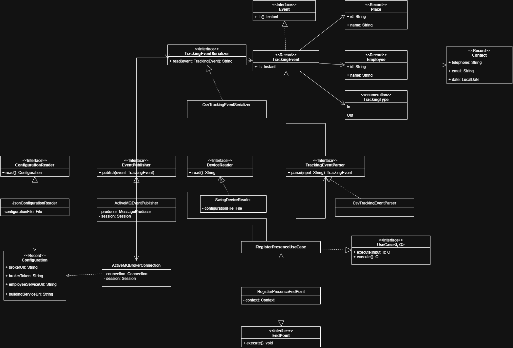
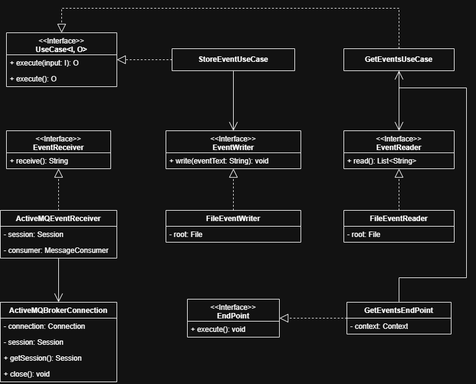
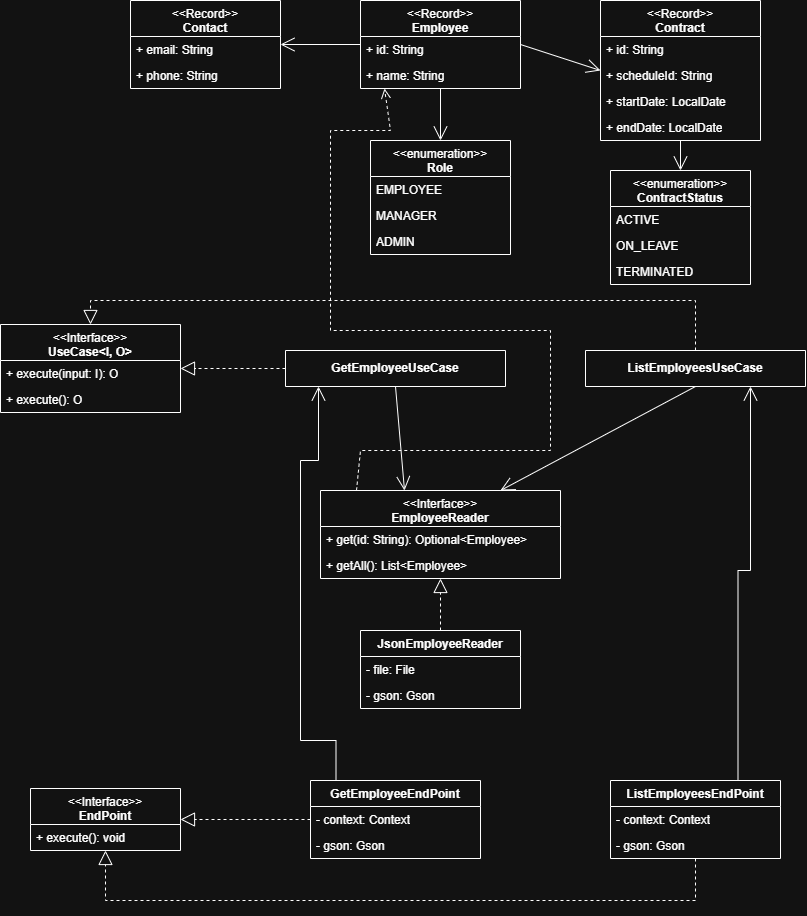
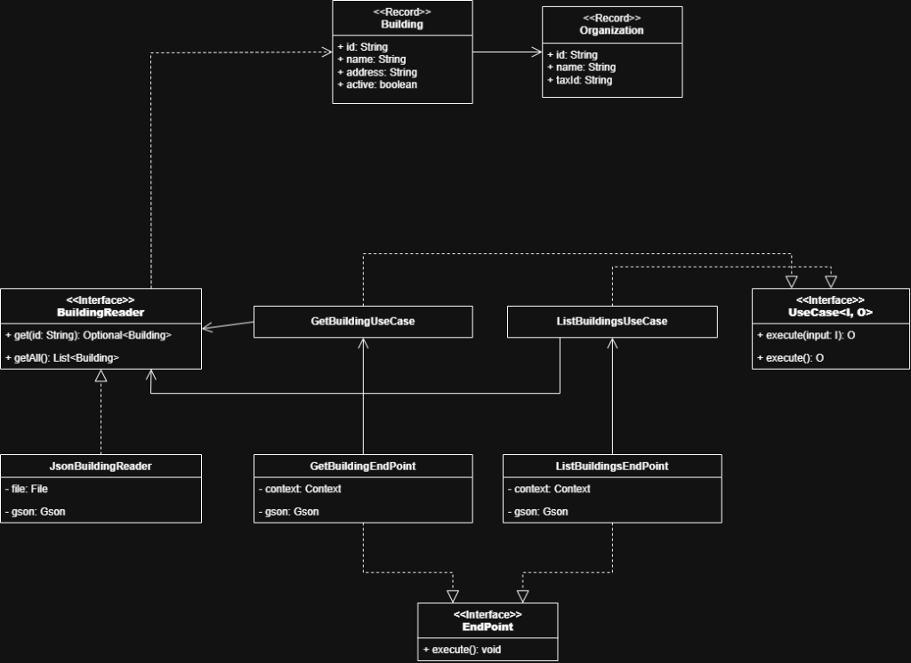

# 📐 Diagramas de Clases y Arquitectura Hexagonal

> **Nota de formato:** Todos los diagramas de arquitectura se publican y mantienen **estrictamente en formato de imagen PNG** (`.png`) para garantizar su compatibilidad y renderización nativa inmediata en GitHub y cualquier visor Markdown.

Este directorio contiene los diagramas de clases UML correspondientes a los microservicios del sistema distribuido de **Control de Presencia**, modelados siguiendo los principios de la **Arquitectura Hexagonal (Puertos y Adaptadores)**, Inversión de Dependencias (**Pure DI**) y **SOLID**.

---

## 1. Módulo `tracking-service` (Captura y Publicación)

Microservicio productor responsable de registrar los fichajes en tiempo real desde terminales físicos o llamadas HTTP y emitirlos como eventos individuales a Apache ActiveMQ.

### Puntos Clave de Diseño:
- **Core Aislado (`model` & `ports`):** Entidades puras e inmutables (`TrackingEvent`, `Employee`, `Place`, `TrackingType`, `Configuration`).
- **Abstracción de Puertos Espejo:**
  - `ports.in.DeviceReader`: Permite conectar dispositivos físicos, terminales simulados o APIs.
  - `ports.processing`: Desacopla la lógica de parseo (`TrackingEventParser`) y formateo (`TrackingEventSerializer`).
  - `ports.out.EventPublisher`: Abstrae la emisión hacia el exterior sin acoplar el core a ActiveMQ ni JMS.
- **Pure DI (Inversión de Dependencias):** Los adaptadores (`SwingDeviceReader`, `ActiveMQEventPublisher`, `CsvTrackingEventParser`, `JsonConfigurationReader`) reciben sus dependencias técnicas por constructor (`private final`).

---

## 2. Módulo `storer` (Ingesta y Data Lake)

Microservicio consumidor encargado de drenar la cola de mensajería, persistir los eventos de forma cronológica en disco (`store/YYYY/MM/YYYYMMDD.log`) con confirmación segura `CLIENT_ACKNOWLEDGE`, y servir la consulta histórica por HTTP.

### Puntos Clave de Diseño:
- **Segregación de Responsabilidades (CQRS):**
  - **Canal de Ingesta (Escritura):** 100% asíncrono vía ActiveMQ (`ActiveMQEventReceiver` $\dashrightarrow$ `StoreEventUseCase` $\longrightarrow$ `FileEventWriter`).
  - **Canal de Consulta (Lectura):** Vía web HTTP (`GetEventsEndPoint` $\longrightarrow$ `GetEventsUseCase` $\longrightarrow$ `FileEventReader`).
- **Garantía Atómica:** El adaptador `ActiveMQEventReceiver` solo invoca `message.acknowledge()` una vez que `FileEventWriter` ha volcado físicamente el registro en disco.
- **Sin Hilos Manuales:** Drenaje secuencial y limpio mediante el timeout nativo de JMS `receive(2000)`.

---

## 3. Módulo `employee-service` (Gestión de Empleados)

Microservicio de consulta de trabajadores, roles, sedes asignadas y contratos laborales vinculados a los tres regímenes horarios exigidos por la rúbrica.

### Puntos Clave de Diseño:
- **Modelo de Dominio Inmutable:** `Employee`, `Role`, `Contact`, `Contract`, `ContractStatus` modelados como `record` y `enum` de Java 27.
- **Puertos de Consulta Segregados:** `EmployeeReader` expone `get(id: String): Optional<Employee>` y `getAll(): List<Employee>`.
- **Adaptador de Infraestructura Desacoplado:** `JsonEmployeeReader` procesa el dataset `employees.json` mediante Gson inyectado por constructor.
- **Adaptadores Web Javalin:** `GetEmployeeEndPoint` (`GET /employees?id={id}`) y `ListEmployeesEndPoint` (`GET /employees`) implementando la interfaz `EndPoint`.

---

## 4. Módulo `building-service` (Gestión de Sedes y Edificios)

Microservicio de consulta de centros de trabajo, organizaciones y localizaciones corporativas donde prestan servicio los trabajadores.

### Puntos Clave de Diseño:
- **Modelo de Dominio Inmutable:** `Building` y `Organization` estructurados como `record` puros.
- **Puerto de Dominio:** `BuildingReader` desacopla la fuente de datos mediante `get(id: String): Optional<Building>` y `getAll(): List<Building>`.
- **Casos de Uso Aislados:** `GetBuildingUseCase` y `ListBuildingsUseCase` implementan `UseCase<I, O>`.
- **Adaptador de Infraestructura:** `JsonBuildingReader` lee de forma segura `buildings.json` gestionando streams y serialización Gson.
- **Endpoints Web:** `GetBuildingEndPoint` (`GET /buildings?id={id}`) y `ListBuildingsEndPoint` (`GET /buildings`) con validación de parámetros y respuestas HTTP tipadas (200, 400, 404).
